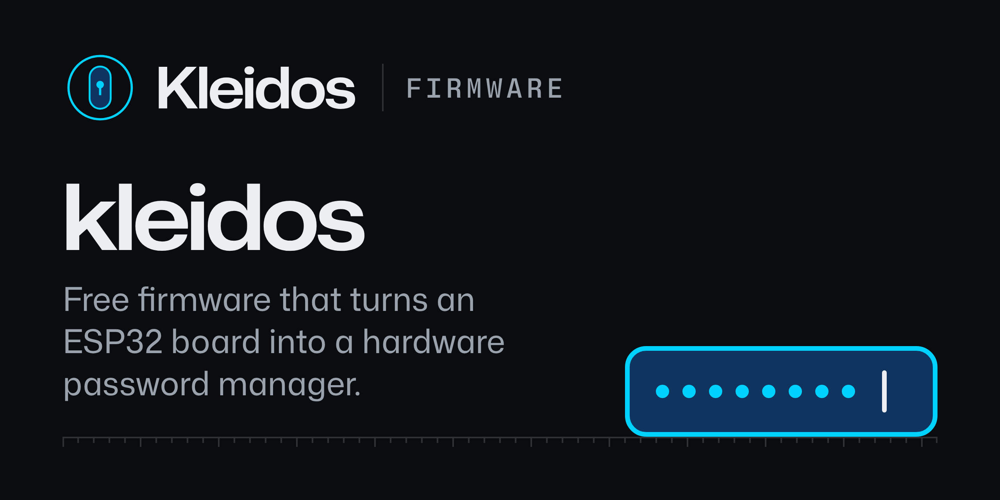

# social

The images [Kleidos](https://kleidos.dev) shows where it has a profile, and the social preview card of every repository of the project. All of them are drawn from the [`brand`](https://github.com/kleidos-dev/brand) repository, which this one holds as a submodule: its mark, its lockup, its colors and its typefaces.

Kleidos is free firmware that turns a small ESP32 board into a hardware password manager.



## What is here

Only what is needed now: YouTube, MakerTube, and one card per repository. Another platform is a source, a row of `pack.json` and an export.

### Profile images

<!-- BEGIN GENERATED: images (tools/export.py); do not edit by hand -->

| File | Pixels | Weight | Where it goes | What it shows |
| --- | --- | --- | --- | --- |
| [`png/youtube/avatar.png`](png/youtube/avatar.png) | 800 x 800 | 31 kB | YouTube: YouTube Studio, Customization, Picture | the mark alone on the stage ground, its ring filling the square every circle crop keeps |
| [`png/makertube/avatar.png`](png/makertube/avatar.png) | 1500 x 1500 | 64 kB | MakerTube (PeerTube): My library, Channels, Update, Avatar | the mark alone on the stage ground, its ring filling the square every circle crop keeps |
| [`png/youtube/banner.png`](png/youtube/banner.png) | 2560 x 1440 | 184 kB | YouTube: YouTube Studio, Customization, Banner image | the lockup, the hero line and the nine boards at one scale on a shelf, each on its unlock screen, inside the area every device shows; ground everywhere else |
| [`png/youtube/watermark.png`](png/youtube/watermark.png) | 600 x 600 | 27 kB | YouTube: YouTube Studio, Customization, Video watermark | the mark alone on transparency, for the corner of the player |
| [`png/youtube/thumbnail.png`](png/youtube/thumbnail.png) | 3840 x 2160 | 170 kB | YouTube: with each video, in its details | the thumbnail template: the lockup, a title a video replaces, and room at the right for its picture |
| [`png/makertube/banner.png`](png/makertube/banner.png) | 1920 x 317 | 32 kB | MakerTube (PeerTube): My library, Channels, Update, Banner | the lockup and the hero line on one row, inside the central band |

<!-- END GENERATED: images -->

The thumbnail is a template. A video's own thumbnail is a one-off that leaves the pack untouched: `.venv/bin/python tools/export.py --title "First line|Second line" --art picture.png --out dist` (at most three lines; the picture, if given, goes in the room at the right).

### Repository cards

One card system for every repository, 2560 x 1280 (twice the size GitHub recommends) and under 1 MB, which is the most GitHub accepts. Upload a card in its repository's Settings, General, Social preview.

<!-- BEGIN GENERATED: cards (tools/export.py); do not edit by hand -->

| Repository | File | Weight | Label | Line | Motif |
| --- | --- | --- | --- | --- | --- |
| `kleidos-dev/kleidos` | [`png/github/kleidos.png`](png/github/kleidos.png) | 130 kB | FIRMWARE | Free firmware that turns an ESP32 board into a hardware password manager. | [`typing`](src/cards/motifs/typing.svg) |
| `kleidos-dev/boards` | [`png/github/boards.png`](png/github/boards.png) | 258 kB | BOARDS | Drawings, measurements, schematics and 3D models of the boards Kleidos runs on. | [`shelf`](src/cards/motifs/shelf.svg) |
| `kleidos-dev/brand` | [`png/github/brand.png`](png/github/brand.png) | 106 kB | BRAND | The logo, type, colors, tokens and press kit. | [`swatches`](src/cards/motifs/swatches.svg) |
| `kleidos-dev/social` | [`png/github/social.png`](png/github/social.png) | 129 kB | SOCIAL | The images of every profile and repository card, generated from brand. | [`frames`](src/cards/motifs/frames.svg) |
| `kleidos-dev/agents` | [`png/github/agents.png`](png/github/agents.png) | 118 kB | AGENTS | Skills and rules for the coding agents that work on Kleidos. | [`checklist`](src/cards/motifs/checklist.svg) |
| `kleidos-dev/.github` | [`png/github/dot-github.png`](png/github/dot-github.png) | 132 kB | COMMUNITY | The organization's profile, contributing guide, security policy and templates. | [`bubbles`](src/cards/motifs/bubbles.svg) |

<!-- END GENERATED: cards -->

A card is the template [`src/cards/card.svg`](src/cards/card.svg) with one row of `pack.json` and one motif. One motif shows real things instead of line drawings: [`shelf`](src/cards/motifs/shelf.svg), the [`boards`](https://github.com/kleidos-dev/boards) repository's, holds the nine board fronts that brand copies from that repository, at one true scale on two rows, each on its unlock screen; the upper row stands on a shelf drawn as the card's own (4 px, the rule color).

| Part | Place and size | Style |
| --- | --- | --- |
| Ground | the whole canvas | the stage color, solid |
| Safe area | 2240 x 1024 at (160, 128), inside the centered 1.91:1 crop some sites apply | a guide |
| Lockup | top left of the safe area, the mark box 193 px | brand's horizontal lockup for a dark ground |
| Hairline and label | after the lockup, on its center line; 68 px | the rule color; Mona Sans Mono 500, capitals, tracked 0.14 em, second ink |
| Title | baseline at 640, 232 px | the display face (width 112.5, weight 650, optical size 72), tracked -0.025 em; the repository's name as GitHub writes it |
| Line | under the title, 84 px, one to three lines inside the 1320 px column | the text face (weight 400, optical size 20), second ink |
| Shelf | at 1120, from 160 to 2400, a tick every 40 px | the rule color, 4 px |
| Motif | stands on the shelf, inside 800 x 480 at (1600, 638) | a 12 px line in the signal color with round caps and joins (8 px for a fine detail), fills from the social palette, ink for a detail |

At 400 px wide, the size a chat or a search result gives a card, the title's capitals are 26 px high, the line's x-height 6.8 px and the mark 30 px; the label is decorative there. At 320 px, the narrowest a page shows a card, the title's capitals are still 21 px high and the mark 24 px, the least brand gives it on a dark ground; the line is decorative there too. `tools/check.py` holds every card to those floors.

**A new repository** is one row under `cards.repos` in `pack.json` (its name, a label, one line and the lines it breaks into, a motif) and an export. It may reuse a motif or bring its own: a file under [`src/cards/motifs/`](src/cards/motifs/), 800 x 480, standing on its bottom edge.

### Previews

For whoever reviews the pack, not for upload. Each one is made from the exported files' own pixels.

<!-- BEGIN GENERATED: previews (tools/export.py); do not edit by hand -->

| File | What it shows |
| --- | --- |
| [`previews/contact-sheet.png`](previews/contact-sheet.png) | Every PNG of the pack. Each exported file, scaled to fit, with its path, its pixels and its weight. The watermark is transparent and sits on a tile. |
| [`previews/avatars.png`](previews/avatars.png) | The avatar, as each platform crops it. In a circle at the sizes YouTube and MakerTube show it, on a dark and on a light page, and the small ones again with each pixel enlarged four times. |
| [`previews/youtube-banner.png`](previews/youtube-banner.png) | The YouTube banner, device by device. What a TV, a computer, a tablet and a phone show of the one file, at half its pixels. |
| [`previews/makertube-banner.png`](previews/makertube-banner.png) | The MakerTube banner, both stored sizes. The 1920 x 317 file at two thirds of its pixels, and the 600 x 100 copy PeerTube also stores, pixel for pixel. |
| [`previews/cards.png`](previews/cards.png) | The repository cards. Each card at half its pixels, at the 640, 400 and 320 px a page or a chat shows it, and in the centered 1.91:1 crop some sites apply. The last one is the template, with a placeholder name. |

<!-- END GENERATED: previews -->

### The platforms' rules

What each image answers to, read at the address and on the day its row states.

<!-- BEGIN GENERATED: rules (tools/export.py); do not edit by hand -->

| Platform | Image | Upload | Limit | Formats | Crop | Keep inside | Read |
| --- | --- | --- | --- | --- | --- | --- | --- |
| YouTube | Profile picture | 800 x 800, 1:1 | under 15.0 MB | JPG, GIF (not animated), BMP or PNG | a circle; shown at 98 x 98 on the channel page and smaller beside videos and comments | the square inside the circle (566 x 566 at 800) | [2026-11-17](https://support.google.com/youtube/answer/10456525). The page gives the formats, the 15 MB limit and the 98 x 98 render size, and no upload size; 800 x 800 is kept from the first pack. |
| YouTube | Channel banner | 2560 x 1440, 16:9 | under 6.0 MB | JPG, GIF (not animated), BMP or PNG | TV shows all of it; a computer a band up to 2560 x 423; a tablet 1855 x 423; a phone 1546 x 423 | 1546 x 423 at (507, 508): the area every device shows | [2026-11-17](https://support.google.com/youtube/answer/10456525). Minimum 2048 x 1152 at 16:9; at that size the safe area for text and logos is 1235 x 338, which is 1546 x 423 at the recommended 2560 x 1440. |
| YouTube | Video watermark | 600 x 600, 1:1 | under 1.0 MB | PNG, GIF (not animated), BMP or JPG | none; shown small in a corner of the player, over the video | the whole square | [2026-11-17](https://support.google.com/youtube/answer/10456525). Minimum 150 x 150, square, less than 1 MB. Transparent, so the video shows around the mark and between its ring and its body. |
| YouTube | Video thumbnail (template) | 3840 x 2160, 16:9 | under 2.0 MB | JPG or PNG | none; the duration badge covers the bottom right corner and the progress bar the bottom edge | 3456 x 1720 at (192, 160), clear of the badge and the bar | [2026-11-17](https://support.google.com/youtube/answer/72431). 3840 x 2160, at least 640 wide, 16:9. The limit is 2 MB from a phone and 50 MB from a computer; the stricter one is kept. |
| MakerTube (PeerTube) | Channel avatar | 1500 x 1500, 1:1 | under 8.0 MB | PNG, JPEG, GIF or WebP | a circle; stored at 1500, 600, 120 and 48 px square | the square inside the circle | [2026-11-17](https://github.com/Chocobozzz/PeerTube/blob/develop/server/core/initializers/constants.ts). ACTOR_IMAGES_SIZE and CONSTRAINTS_FIELDS.ACTORS.IMAGE in PeerTube's source. The instance's own configuration was read for the first pack on 2026-11-10 and gave the same limits; it was not read again. |
| MakerTube (PeerTube) | Channel banner | 1920 x 317, about 6:1 | under 8.0 MB | PNG, JPEG, GIF or WebP | stored at 1920 x 317 and 600 x 100; a narrow page shows the middle | the central 1440 x 317 | [2026-11-17](https://github.com/Chocobozzz/PeerTube/blob/develop/server/core/initializers/constants.ts). The same constants as the avatar. |
| GitHub | Repository social preview | 2560 x 1280, 2:1 | under 1.0 MB | PNG, JPG or GIF | none on GitHub; some sites that show the link crop it to 1.91:1, centered | 2240 x 1024 at (160, 128), inside the centered 1.91:1 crop | [2026-11-17](https://docs.github.com/en/repositories/managing-your-repositorys-settings-and-features/customizing-your-repository/customizing-your-repositorys-social-media-preview). Under 1 MB; at least 640 x 320, 1280 x 640 for best display; a solid background is recommended. Twice the recommended size, by the owner's decision. |

<!-- END GENERATED: rules -->

### Not made

<!-- BEGIN GENERATED: not-made (tools/export.py); do not edit by hand -->

| Platform | Image | Why not |
| --- | --- | --- |
| GitHub | Organization picture | The organization already has its picture; it moves here when the profile's banner does. |
| YouTube | Shorts thumbnail, end screen | No Short and no end screen is planned; each is a source, a row and an export the day one is. |
| MakerTube | Video thumbnail | A video's thumbnail is made with the video; the YouTube template at half size serves until then. |
| Mastodon, Bluesky, LinkedIn, X, dev.to, Hackaday, Hackster, Elektor, Matrix | Everything the first pack drew for them | Not needed now; each is a source, a row and an export the day one is. |

<!-- END GENERATED: not-made -->

## Building

```sh
git submodule update --init          # brand from its public address, https://github.com/kleidos-dev/brand.git
# a local brand beside this clone instead:
#   git config submodule.brand.url ../brand && git -c protocol.file.allow=always submodule update --init
python3 -m venv .venv
.venv/bin/pip install -r requirements.txt
.venv/bin/python -m playwright install chromium

.venv/bin/python tools/export.py                     # draw every image, card and preview
.venv/bin/python tools/export.py --check             # draw everything again, compare pixel for pixel
.venv/bin/python tools/export.py --check --static    # what needs no browser
.venv/bin/python tools/export.py --check --tolerant  # draw again under any browser, fail on gross drift
.venv/bin/python tools/check.py                      # the tree's rules
.venv/bin/python -m pytest tests
.venv/bin/reuse lint
```

Python 3.14. The sources under `src/` are small SVG files with three layers (`ground`, `content`, `guides`) and live words in Mona Sans, so they open in any SVG editor that has brand's fonts. The exporter fills in the lockup from brand, turns the words into outlines, drops the guides, and has Playwright's Chromium draw the result, headless; Pillow encodes again from the pixels alone, so no file carries a text chunk. `exports.json` records the browser's version and, for each picture, its bytes and the bytes of everything it was drawn from, the brand files included: when the submodule moves and one of them changed, every picture is stale until it is exported again and looked at.

The pins (Pillow, Playwright, fontTools, HarfBuzz) are brand's, in `brand/requirements.txt`, so both repositories draw with one browser and one encoder. The exact comparison is the exporting machine's: another Chromium draws an edge a shade apart, so `--check` refuses to compare under a different version, and CI runs the static and the tolerant checks.

## License

The artwork (the SVG sources, the motifs, the exported images and their previews) and the pack's data are licensed under the [GNU General Public License, version 3 or any later version](LICENSE) (GPL-3.0-or-later), the firmware's license. The tooling (the code under `tools/`, the tests, the CI, the pins and the configuration, with the commit-message gate copied from the project's `agents` repository) is under the [MIT License](LICENSES/MIT.txt), as brand's is. Both are approved by the Open Source Initiative; nothing in this repository is under any other license. Credits: [`NOTICE.md`](NOTICE.md); file by file: `REUSE.toml`.

Kleidos is not a registered trademark. As section 7(e) of the GPL allows, the license grants no rights under trademark law in the name "Kleidos" or in the Kleidos mark. As section 7(c) allows, a modified version of a file under the GPL here must be marked as different from the original and must not misrepresent its origin; a file passed on unchanged needs nothing. [`TRADEMARKS.md`](TRADEMARKS.md), a copy of brand's, says what that means and what the project asks of those who use its name. Writing about Kleidos? The images made for that are brand's press kit, not these.

## Contact

mail@kleidos.dev. Kleidos is made by José M. Requena Plens (<https://github.com/jmrplens>). The project's repositories are in the [kleidos-dev](https://github.com/kleidos-dev) organization.
